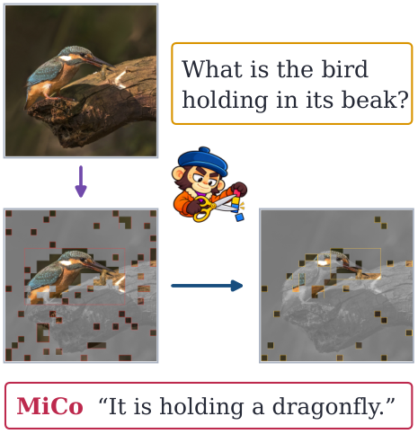
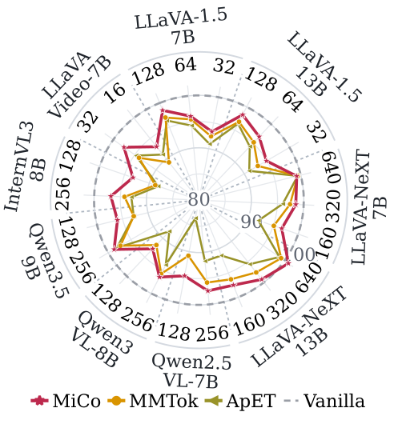
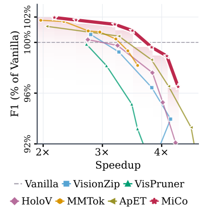
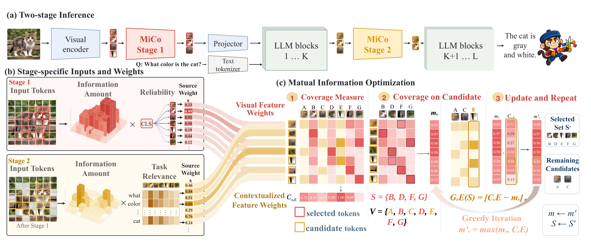
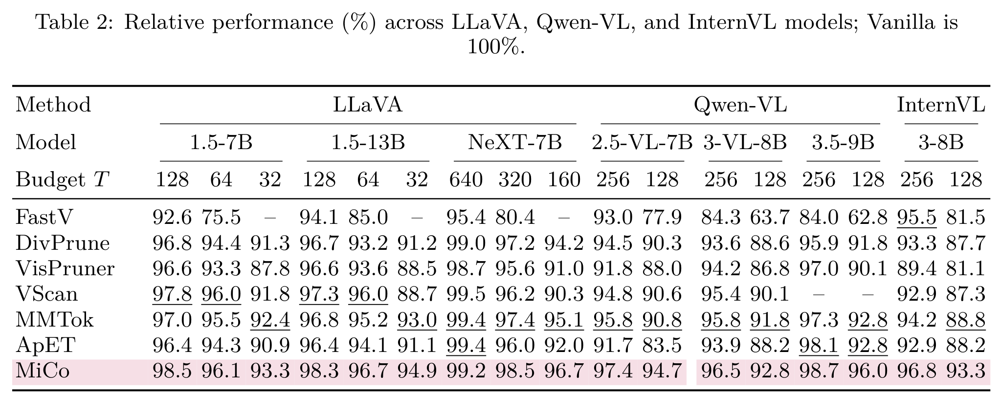
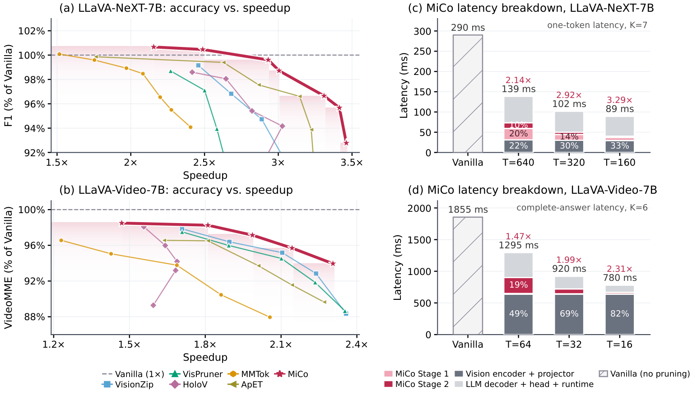
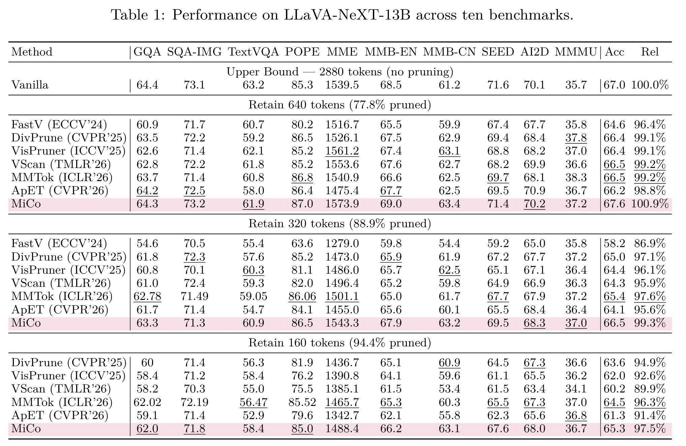

<div align="center">


# MiCo

### Mutual Information Coverage Optimization through Semantic Erasure Modeling<br>for Efficient MLLM Inference

<p align="center">
Tinghao Wang<sup>1,2,*</sup>, Yichen Guo<sup>1,3,*</sup>, Qizhe Zhang<sup>1</sup>, Yuan Zhang<sup>1</sup>, Weimin Ouyang<sup>1</sup>,<br>
Rui Huang<sup>4</sup>, Jiajun Cao<sup>1</sup>, Sixiang Chen<sup>1</sup>, Hao Jiang<sup>1,2</sup>, Jixian Wu<sup>5</sup>,<br>
Zheng Lu<sup>2</sup>, Bofan Zhu<sup>2</sup>, Renyuan Li<sup>2</sup>, Shanghang Zhang<sup>1,†</sup>
</p>

</div>

<p align="left">
<sup>1</sup> State Key Laboratory of Multimedia Information Processing, School of Computer Science, Peking University; <sup>2</sup> University of Electronic Science and Technology of China; <sup>3</sup> Nanyang Technological University; <sup>4</sup> The University of Hong Kong; <sup>5</sup> New York University
</p>

<div align="center">

<p align="center">
<sup>*</sup> Equal contribution. &nbsp; <sup>†</sup> Corresponding author.
</p>

**Training-free visual token pruning · Image & video understanding · 7B–13B models**

[Paper](https://arxiv.org/abs/2609.34330) · [Method](#method) · [Results](#results) · [Quick start](#quick-start) · [Evaluation guide](docs/RUNNING.md)

</div>

---

MiCo selects a compact set of visual evidence through **two stages of mutual information coverage optimization**: a representative visual candidate pool before the language model, followed by task-aware refinement inside it.

<table>
<tr>
<th align="center">94.4% visual tokens pruned</th>
<th align="center">97.5% relative performance</th>
<th align="center">2.31× video speedup</th>
</tr>
<tr>
<td align="center">LLaVA-NeXT-13B · T = 160</td>
<td align="center">NeXT-13B · ten-benchmark aggregate</td>
<td align="center">LLaVA-Video-7B · T = 16/frame</td>
</tr>
</table>

<p align="center">



</p>

<p align="center"><sub>Original paper teaser panels: visual evidence selection, cross-model performance, and the quality–speed trade-off.</sub></p>

> Results shown here are reported in the paper. Repository verification and paper benchmark reproduction are tracked separately in [Validation](#validation).

## Method

<a href="assets/method.pdf"></a>

1. **Visual candidate selection.** Use feature magnitude, visual attention, and coverage to retain representative evidence before LLM processing.
2. **Task-aware refinement.** Use text-to-visual attention at the selected decoder layer to refine that candidate pool under a token budget.

Both stages greedily optimize an observable weighted coverage objective. The paper establishes monotonicity and submodularity for this surrogate. The stage-2 budget is chosen to match the target layer-average token count.

## Results

### Across model families

<a href="assets/results-table.pdf"></a>

The original table reports relative performance against each model's unpruned reference. It covers LLaVA, Qwen2.5-VL, Qwen3-VL, Qwen3.5, and InternVL3 at the paper's token budgets.

### Quality and inference efficiency

<a href="assets/efficiency.pdf"></a>

**Image and video protocols differ:** NeXT plots use one-token latency; video plots use complete-answer latency. See the paper for the benchmark and generation protocol behind each point.

<details>
<summary><strong>View the original LLaVA-NeXT-13B results table</strong></summary>

<a href="assets/next13b-table.pdf"></a>

</details>

## Supported models

| Model family | Implementation | Environment |
| :--- | :--- | :--- |
| LLaVA-1.5 / LLaVA-NeXT · 7B & 13B | [LLaVA-MiCo](LLaVA-MiCo) | `fastv` |
| LLaVA-Video · 7B | [LLaVA-Video-MiCo](LLaVA-Video-MiCo) | `llavavid` |
| Qwen2.5-VL · 7B / InternVL3 · 8B | [VLMEvalKit-MiCo](VLMEvalKit-MiCo) | `vlmevalkit-qwen2.5vl` |
| Qwen3-VL · 8B | [VLMEvalKit-MiCo-Qwen3](VLMEvalKit-MiCo-Qwen3) | `vlmevalkit-qwen3vl` |
| Qwen3.5 · 9B | [Qwen3.5-MiCo](Qwen3.5-MiCo) | `vlmevalkit-qwen3vl` |

## Quick start

Choose the model family below. Each group includes environment setup and a runnable launcher example. Use **Linux with an NVIDIA GPU**, and download the model weights and benchmark data separately.

```bash
git clone https://github.com/MAX-7237/MiCo.git
cd MiCo
export REPO_ROOT="$PWD"
```

Run the setup block for the component you need. If its Conda environment already exists, skip `conda create` and activate it. Keep the environment profiles separate: image LLaVA, video LLaVA, and the Qwen families use different Transformers versions. Dependency pins and installation caveats are documented in the [environment guide](docs/RUNNING.md#environments).

The commands below run inference or evaluation directly, assuming the environment, datasets, and model weights are configured. Replace `/path/to/...` with your local paths.

### 1. LLaVA image models — four backbones

```bash
cd "$REPO_ROOT/LLaVA-MiCo"
conda create -n fastv python=3.10 -y
conda activate fastv
python -m pip install -r requirements.txt
python -m pip check
```

| Backbone | `--model` | `--tokens` choices |
| :--- | :--- | :--- |
| LLaVA-1.5-7B | `llava-1.5-7b` | `128`, `64`, `32` |
| LLaVA-1.5-13B | `llava-1.5-13b` | `128`, `64`, `32` |
| LLaVA-NeXT-7B (Vicuna) | `llava-next-7b` | `640`, `320`, `160` |
| LLaVA-NeXT-13B (Vicuna) | `llava-next-13b` | `640`, `320`, `160` |

MiCo passes the NeXT total budget directly to the implementation: use `640/320/160`.

Prepare the benchmark question JSONL and image directory, then choose one of the four commands:

```bash
python run_mico.py --model llava-1.5-7b --tokens 128 \
  --question-file /path/to/questions.jsonl --image-folder /path/to/images \
  --answers-file outputs/llava-1.5-7b/answers.jsonl

python run_mico.py --model llava-1.5-13b --tokens 128 \
  --question-file /path/to/questions.jsonl --image-folder /path/to/images \
  --answers-file outputs/llava-1.5-13b/answers.jsonl

python run_mico.py --model llava-next-7b --tokens 640 \
  --question-file /path/to/questions.jsonl --image-folder /path/to/images \
  --answers-file outputs/llava-next-7b/answers.jsonl

python run_mico.py --model llava-next-13b --tokens 640 \
  --question-file /path/to/questions.jsonl --image-folder /path/to/images \
  --answers-file outputs/llava-next-13b/answers.jsonl

```

The launcher selects the default Hugging Face model ID for each alias; use `--model-path /path/to/weights` for local image-model weights. These commands write predictions. Run the relevant benchmark scorer afterwards; MMBench and ScienceQA also provide dedicated evaluation modules under `llava/eval`.

### 2. LLaVA-Video — 7B Qwen2

Video has its own environment; do not install its dependencies into `fastv`.

```bash
cd "$REPO_ROOT/LLaVA-Video-MiCo"
conda create -n llavavid python=3.10 -y
conda activate llavavid
python -m pip install -r requirements.txt
python -m pip install --no-build-isolation -r requirements-flash-attn.txt
python -m pip check

python run_mico.py --model llava-video-7b --tokens 32 \
  --model-path lmms-lab/LLaVA-Video-7B-Qwen2 \
  --dataset videomme --nproc 1 --work-dir outputs/video
```

The adapter uses the Qwen conversation template and samples up to **64 frames**. The token budget is **per frame** (`32/16`). Prepare VideoMME according to `lmms-eval/lmms_eval/tasks/videomme`, or select another registered video task with `--dataset`. Predictions and evaluation artifacts go under `--work-dir`. The recovered video environment remains a candidate profile pending GPU validation.

### 3. Qwen2.5-VL and InternVL3

Both backbones share `vlmevalkit-qwen2.5vl` and the VLMEvalKit entry point.

```bash
cd "$REPO_ROOT/VLMEvalKit-MiCo"
conda create -n vlmevalkit-qwen2.5vl python=3.11 -y
conda activate vlmevalkit-qwen2.5vl
python -m pip install -r requirements.txt
python -m pip install --no-build-isolation -r requirements-flash-attn.txt
python -m pip check

# Qwen2.5-VL-7B-Instruct
python run_mico.py --model qwen2.5-vl-7b --tokens 256 \
  --dataset AI2D_TEST --nproc 1 --work-dir outputs/qwen25

# InternVL3-8B
python run_mico.py --model internvl3-8b --tokens 256 \
  --dataset AI2D_TEST --nproc 1 --work-dir outputs/internvl3
```

Use `--tokens 256` or `128`. Set `LMUData` to your dataset/cache directory when needed, and follow the selected VLMEvalKit dataset adapter's preparation instructions. To use local model weights, edit the matching entry in `vlmeval/config.py`; these VLMEval launchers do not accept `--model-path`. Some benchmarks require an external judge model in addition to inference.

FlashAttention must be built **after PyTorch**, with a compatible CUDA toolkit and compiler. See the [environment guide](docs/RUNNING.md#environments) for the pinned versions.

### 4. Qwen3-VL and Qwen3.5

These components share `vlmevalkit-qwen3vl` (Python 3.12, PyTorch 2.7.0, Transformers 5.2.0). Their entry points differ: Qwen3-VL uses VLMEvalKit, while Qwen3.5 provides single-image inference.

**Qwen3-VL-8B benchmark evaluation**

```bash
cd "$REPO_ROOT/VLMEvalKit-MiCo-Qwen3"
conda create -n vlmevalkit-qwen3vl python=3.12 -y
conda activate vlmevalkit-qwen3vl
python -m pip install -r requirements.txt
python -m pip check

python run_mico.py --model qwen3-vl-8b --tokens 128 \
  --dataset AI2D_TEST --nproc 1 --work-dir outputs/qwen3
```

Use budgets `256/128`. Dataset preparation and local-weight configuration follow the same VLMEvalKit conventions as the preceding group.

**Qwen3.5-9B single-image inference**

Activate the shared environment created above. If you only need Qwen3.5, create it with `conda create -n vlmevalkit-qwen3vl python=3.12 -y` first.

```bash
cd "$REPO_ROOT/Qwen3.5-MiCo"
conda activate vlmevalkit-qwen3vl
python -m pip install -r requirements.txt
python -m pip check

python run_mico.py --model-path Qwen/Qwen3.5-9B \
  --image /path/to/image.jpg --question 'What is shown in the image?' \
  --tokens 128 --trace-file outputs/trace.json
```

The default is the MiCo QK recipe at layer 12, with SDPA, one image, batch size one, and cached greedy decoding. Use budgets `128/256`. The answer is printed and pruning diagnostics are saved to `--trace-file`. This is a single-image inference entry, not a complete benchmark scoring pipeline. See the [Qwen3.5 guide](Qwen3.5-MiCo/README.md) for controls and core tests.

See the [full evaluation guide](docs/RUNNING.md#evaluation) for additional configuration and scoring details.

## Validation

This is a **source-preview release**. Static checks and launcher dry runs pass; the recovered Qwen3.5 core also passes seven random-weight CPU model tests. Full clean-environment installation and real-weight GPU benchmark reproduction remain pending. See [validation records](VALIDATION.json) and [Qwen3.5 checks](Qwen3.5-MiCo/VALIDATION.json).

The README uses original figures and LaTeX tables from the paper project. PDF images are rasterized for GitHub display; click them for the vector originals. [Asset provenance](assets/SOURCES.json) records source files and hashes.

## Citation

```bibtex
@article{wang2026mico,
  title={MiCo: Mutual Information Coverage Optimization through Semantic Erasure Modeling for Efficient MLLM Inference},
  author={Wang, Tinghao and Guo, Yichen and Zhang, Qizhe and Zhang, Yuan and Ouyang, Weimin and Huang, Rui and Cao, Jiajun and Chen, Sixiang and Jiang, Hao and Wu, Jixian and Lu, Zheng and Zhu, Bofan and Li, Renyuan and Zhang, Shanghang},
  journal={arXiv preprint arXiv:2609.34330},
  year={2026}
}
```

## Acknowledgements

Built on LLaVA, LLaVA-NeXT/LLaVA-Video, VLMEvalKit, lmms-eval, and Transformers. Component licenses and original third-party attribution are preserved in their respective directories.
